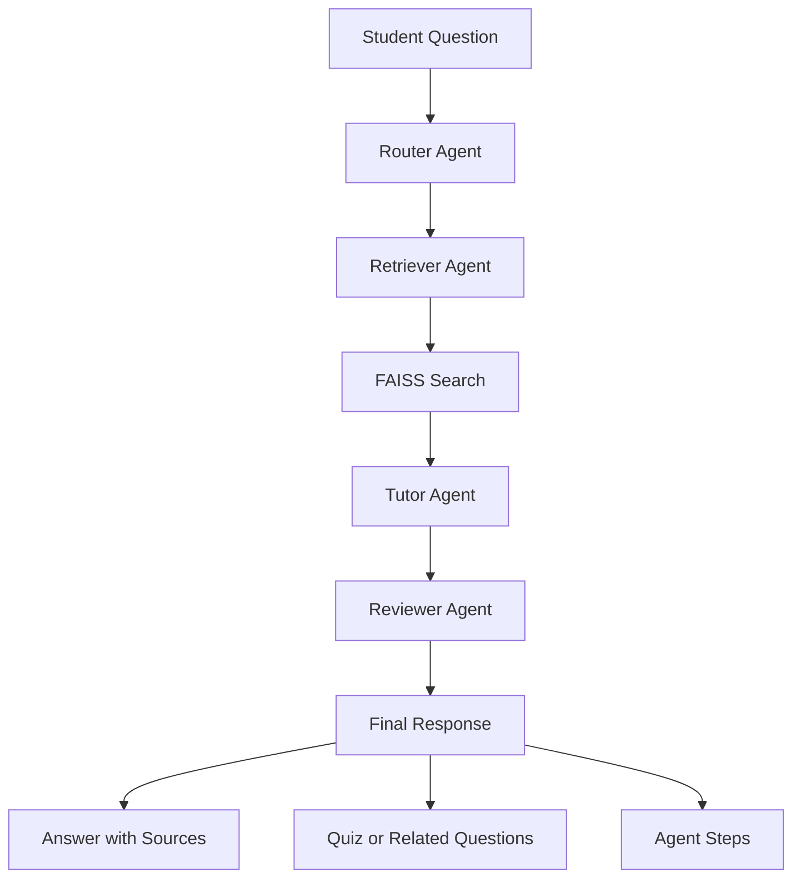
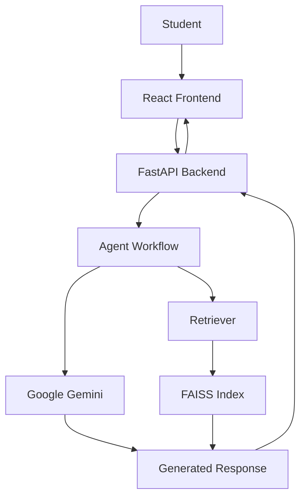

# Subject Guide & Question Bank AI Agent

An AI-powered study assistant that helps students understand academic subjects, solve questions step by step, practise with quizzes, and track their learning progress using their own study materials.

The system uses Retrieval-Augmented Generation (RAG) and a multi-agent workflow to provide context-aware answers with source references.

## Live Demos

| Version | Technology | Live Application |
|---|---|---|
| Track A | Streamlit | [Open Streamlit App](https://subject-guideagent-nvmsyd5d2gmqcemdjpjhgz.streamlit.app/) |
| Track B | React + FastAPI | [Open React App](https://subject-guide-agent.onrender.com) |

**Track A** is the original Streamlit application.

**Track B** is the redesigned React frontend connected to a FastAPI backend and deployed using Docker.

Both versions are maintained separately. The original Streamlit application remains available.

---

## Problem Statement

Students often have difficulty understanding academic topics, finding relevant questions, and preparing effectively for examinations.

Study materials may be spread across PDFs, presentations, and documents, making it difficult to locate the right information quickly.

This project aims to provide a single AI-powered study environment that can use course materials to explain concepts, answer questions, generate quizzes, and support exam preparation.

## Target Users

- College and university students
- Students preparing for examinations
- Learners who want explanations based on their own study materials
- Students who need additional practice and revision support

## Key Objectives

- Provide answers grounded in uploaded academic materials.
- Explain difficult topics in a student-friendly way.
- Solve academic questions step by step.
- Generate multiple-choice quizzes.
- Retrieve relevant questions from indexed materials.
- Track study activity and identify areas that need revision.
- Provide source references to support generated answers.

---

## Team and Responsibilities

| Team Member | Contribution |
|---|---|
| Ioniixia | Project development, AI integration, application implementation and deployment |
| yitong2907 | Project collaboration and development |

---

## Project Development Progress

| Week | Planned Work | Status |
|---|---|---|
| Week 1 | Repository setup, project documentation, document loading, chunking and FAISS indexing | Completed |
| Week 2 | Multi-format document ingestion, source tagging, RAG pipeline and Streamlit interface | Completed |
| Week 3 | Study modes, subject and chapter filters, and AIML study material indexing | Completed |
| Week 4 | Question bank, quiz generation, related questions and public deployment | Completed |
| Week 5 | Agent workflow, syllabus and topic tagging, and coverage reporting | Implemented |
| Week 6 | Practice features, progress tracking, weak-area detection, study planning and backend API | Implemented |
| Week 7 | React frontend, guardrails and edge-case testing | Implemented |
| Week 8 | Docker deployment, public deployment and documentation updates | Deployment completed; documentation updated |

---

## Features

### 1. AI Agent Workflow

The application uses a multi-stage workflow:

- **Router:** Identifies the type of student request.
- **Retriever:** Searches indexed study materials for relevant information.
- **Tutor:** Generates explanations and answers using retrieved context.
- **Reviewer:** Reviews the generated response before it is presented.

### 2. Study Modes

Students can use different modes depending on what they need:

- Ask a question.
- Solve a problem step by step.
- Learn a topic.

### 3. Quiz Generation

- Generates multiple-choice questions.
- Provides answer options.
- Supports revision and self-assessment using indexed material.

### 4. Related Questions

Retrieves related questions from the available question bank and study materials to support further practice.

### 5. Subject and Chapter Filtering

Students can narrow their study content using available subject, chapter and source-type filters.

### 6. Marks-Based Answers

Students can specify the expected marks, such as 2, 5 or 10, to guide the expected answer depth.

### 7. Source References

Responses can include references to the retrieved source material, including document and page information when available.

### 8. Document Upload

Supports academic materials in:

- PDF
- DOCX
- PPTX

### 9. Learning Progress

Includes study progress features and weak-area identification to help students decide what to revise.

### 10. Study Planning and Coverage

Includes study planning and syllabus coverage features to support structured preparation.

---

## Application Versions

### Track A — Streamlit

The original application provides a Streamlit-based interface for interacting with the AI study assistant.

**Technology stack:**
- Python
- Streamlit
- LangChain
- FAISS
- Sentence-Transformers
- Google Gemini

Live application: [Subject Guide Agent — Streamlit](https://subject-guideagent-nvmsyd5d2gmqcemdjpjhgz.streamlit.app/)

### Track B — React + FastAPI

The second version introduces a redesigned React frontend and a FastAPI backend.

**Frontend:**
- React
- Vite
- React Markdown

**Backend and AI:**
- Python
- FastAPI
- Uvicorn
- FAISS
- Sentence-Transformers
- Google Gemini

**Deployment:**
- Docker
- Render
- Hugging Face Spaces-compatible Docker configuration

The frontend includes a workspace layout, navigation tabs, selectable study modes, a question composer, result sections, and study actions.

Live application: [Subject Guide Agent — React](https://subject-guide-agent.onrender.com)

### Track B Verification

The deployed application was tested for:

- Backend startup and public accessibility.
- Frontend and backend connectivity.
- PDF upload.
- Retrieval from uploaded study material.
- Question answering using uploaded content.
- MCQ quiz generation.
- Source references in generated responses.

---

## System Architecture

### Agent Workflow



### Application Architecture



The application processes academic materials, creates searchable document representations, retrieves relevant content, and uses the language model to generate context-aware responses.

---

## Available Study Tools

| Tool | Purpose |
|---|---|
| Ask Question | Answer questions using indexed study materials |
| Learn Topic | Explain academic concepts |
| Solve Problem | Provide step-by-step problem-solving support |
| Generate Quiz | Create multiple-choice questions |
| Related Questions | Retrieve related questions for practice |
| Practice | Support additional study practice |
| Progress Tracking | Monitor learning activity |
| Weak-Area Detection | Identify topics that may need revision |
| Study Plan | Support structured revision |
| Coverage Report | Review syllabus and topic coverage |

---

## Technical Implementation

### 1. Document Ingestion

The application supports loading academic documents in PDF, DOCX and PPTX formats.

### 2. Text Chunking

Documents are divided into smaller chunks to support efficient retrieval.

### 3. Metadata and Source Tagging

Document chunks can be associated with metadata such as subject, chapter, source and page information.

### 4. Embeddings and Vector Search

Sentence-Transformers generates vector embeddings for document chunks.

FAISS is used to store and search the indexed vectors.

### 5. Retrieval-Augmented Generation

Relevant chunks are retrieved based on the student's question and passed to the language model as context.

### 6. Response Generation

Google Gemini generates explanations, answers and study content using the retrieved information.

### 7. Review and Response

The reviewer stage checks the generated response before it is returned to the student.

---

## Model Evaluation

Different Gemini models were evaluated to compare response speed, answer quality, citation coverage and reliability.

| Model | Response Time | Evaluation Score | Citation Result | Errors |
|---|---:|---:|---:|---:|
| gemini-2.5-flash-lite | Unavailable | N/A | N/A | 5/5 |
| gemini-3.1-flash-lite | 1.5 s | 93% | 5/5 | 0 |
| gemini-flash-latest | 100.3 s | 100% | 3/3 | 2 (503) |
| gemini-3.5-flash | 4.4 s | 83% | 4/4 | 1 (503) |

**Selected model:** `gemini-3.1-flash-lite`

It was selected based on the evaluation results, balancing response speed, answer quality, citation coverage and reliability.

### Embedding Model

`sentence-transformers/all-MiniLM-L6-v2`

This model is used to generate embeddings for semantic document retrieval.

*Note: Evaluation figures represent the recorded project tests and may vary with subsequent model or API changes.*

---

## Error Handling and Logging

The application includes:

- Validation for empty questions.
- Retry and fallback handling for model errors.
- Alternative model selection when a model request fails.
- Agent-step tracking and timing information.
- Error handling for application requests.

---

## Run Locally

### Prerequisites

- Python
- Node.js and npm
- Git
- A Google Gemini API key

### 1. Clone the repository

```bash
git clone https://github.com/Ioniixia/Subject-Guide_agent.git
cd Subject-Guide_agent
```

### 2. Set up the Python backend

Create a virtual environment:

```bash
python -m venv venv
```

Activate it on Windows:

```powershell
.\venv\Scripts\Activate.ps1
```

Install dependencies:

```bash
pip install -r requirements.txt python-multipart
```

Create a `.env` file in the project root:

```env
GEMINI_API_KEY=your_key_here
```

Replace `your_key_here` with your own API key.

Do not commit your `.env` file or expose your API key publicly.

### 3. Start the FastAPI backend

From the project root:

```bash
python -m uvicorn main:app --app-dir app --reload --host 127.0.0.1 --port 7860
```

The backend will be available at:

`http://127.0.0.1:7860`

### 4. Start the React frontend

Open a second terminal:

```bash
cd frontend
npm ci
npm run dev
```

Vite will display the frontend address in the terminal.

Open that address in your browser.

In the application's Settings, set the backend server address to:

`http://127.0.0.1:7860`

### 5. Run the original Streamlit application

From the project root, activate the Python environment if necessary and run:

```bash
python -m streamlit run app/streamlit_app.py
```

### 6. Run frontend tests

From the `frontend` directory:

```bash
npm test
```

### 7. Build the frontend

From the `frontend` directory:

```bash
npm run build
```

The production frontend files are generated in:

`frontend/dist`

---

## Docker Deployment

Track B uses a multi-stage Docker build.

The first stage installs frontend dependencies and builds the React application.

The second stage installs Python dependencies, prepares the embedding model cache, copies the backend and serves the built frontend through FastAPI.

Build the Docker image:

```bash
docker build -t subject-guide-agent .
```

Run the container:

```bash
docker run -p 7860:7860 --env-file .env subject-guide-agent
```

The application will be available at:

`http://localhost:7860`

The container uses Uvicorn to serve the application on port `7860`.

---

## Using Your Own Study Materials

The project can be adapted to different academic subjects by using your own study materials and updating the associated metadata.

The main areas to review are:

- `data/` — study materials and supporting data.
- `src/build_index.py` — document indexing logic.
- `data/syllabus.json` — syllabus information.
- Topic and question metadata — used for subject, chapter and topic organization.

After changing the materials or metadata, rebuild the relevant index and update the coverage information using the project's indexing and coverage scripts.

---

## Project Structure

```text
Subject-Guide_agent/
│
├── app/
│   ├── streamlit_app.py
│   └── main.py
│
├── frontend/
│   ├── src/
│   │   ├── components/
│   │   ├── pages/
│   │   ├── App.jsx
│   │   └── styles.css
│   ├── package.json
│   └── vite.config.js
│
├── src/
│   ├── build_index.py
│   └── document processing and indexing modules
│
├── data/
│   ├── study materials
│   ├── syllabus.json
│   └── topic and question metadata
│
├── faiss_index/
│
├── requirements.txt
├── Dockerfile
├── README.md
└── .env
```

---

## Future Improvements

Potential future enhancements include:

- More advanced personalized learning recommendations.
- Expanded question-bank support.
- Additional document formats.
- More detailed learning analytics.
- Improved syllabus coverage visualization.
- Further testing across different academic subjects.

---

## Acknowledgements

This project was developed as an academic AI application focused on improving the student learning and examination preparation experience through document retrieval, language models and an agent-based workflow.

**Repository:** [Subject-Guide_agent on GitHub](https://github.com/Ioniixia/Subject-Guide_agent)