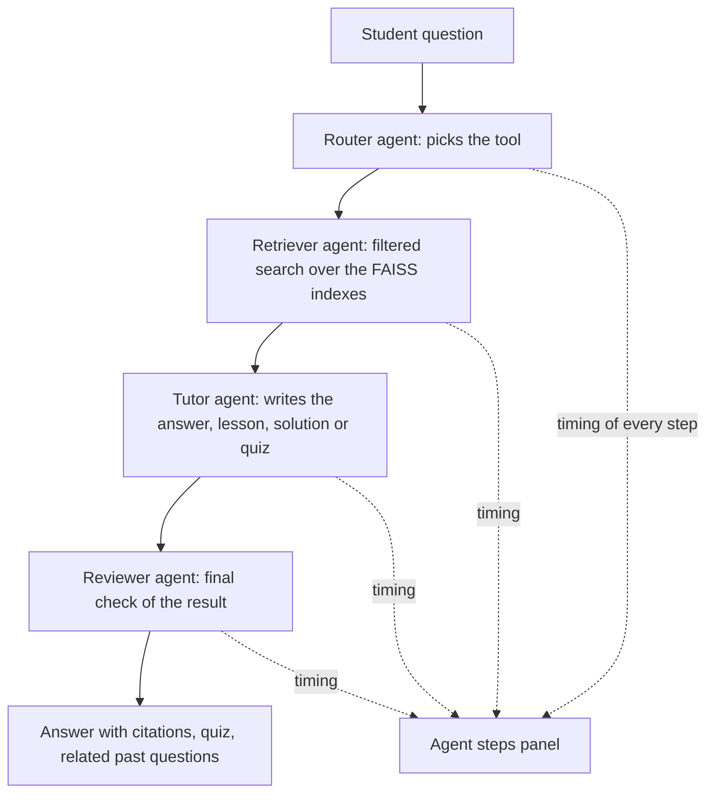

# Subject Guide & Question Bank AI Agent

An AI study assistant for students. It reads your course material (PDF, DOCX, PPTX), then explains topics, answers questions, solves problems, and quizzes you, using only that material, with the source of every answer cited.

**Live demo:**  https://subject-guideagent-nvmsyd5d2gmqcemdjpjhgz.streamlit.app/

## Problem statement
Students keep their course material in many places: lecture slides, textbook chapters, lab manuals, and past question papers. When they revise, they cannot quickly get an explanation of one topic that is based on their own material, linked to the exam questions on that topic, and clear about where each statement comes from.

## Target users
Undergraduate students preparing for semester exams (built and tested with AIML course material), and anyone who wants to study from their own files.

## Success criteria
- Every answer shows the file and the slide or page it came from
- Answers use only the material provided, and say so when the material does not cover a question
- Every syllabus topic has study material and at least one past question, tracked by the coverage report (`src/coverage_check.py`)
- The app runs at a public link and works with a student's own uploaded files

## Team and responsibilities
| Member | Role |
|---|---|
| Ioniixia | Data and retrieval: document loading, chunking, metadata tagging, FAISS index, syllabus and question tagging, coverage report, deployment, README |
| Yitong | Agent and app: agent steps, Gemini answer generation, study modes, quiz, related past questions, filters, Streamlit interface |

## 8-week plan
| Week | Deliverable | Status |
|---|---|---|
| 1 | Repository, README, problem statement, document loading, chunking, FAISS index | Done |
| 2 | Multi-format ingestion (PDF, DOCX, PPTX), source tagging, working RAG pipeline, Streamlit app | Done |
| 3 | Study modes (ask, solve, learn), subject and chapter filters, AIML notes indexed | Done |
| 4 | Question bank, quiz, related past questions, source-type filter, public deployment | Done |
| 5 | Agent pipeline (Router, Retriever, Tutor, Reviewer), syllabus, topic tags, coverage report | Done |
| 6 | Practice mode, progress tracking, weak-area detection, study plan, backend API | Planned |
| 7 | Framework-based frontend, guardrails (input validation, fallbacks), edge-case testing | Planned |
| 8 | Final deployment, README, demo video, presentation | Planned |

## Features
- **Agent mode (default):** each question goes through Router, Retriever, Tutor, and Reviewer steps, and the *Agent steps* panel shows the timing of each one. *Smart routing* lets Gemini pick the tool.
- **Study modes:** *Ask a question*, *Solve a problem* (step-by-step working), and *Learn a topic* (theory, example, practice)
- **Test yourself:** a short quiz on the topic
- **Related past questions:** matching exam questions, each with a *Solve this question* button
- **Filters:** subject, chapter, and source type (notes, textbook, lab manual, question paper)
- **Marks field:** sets the answer length to match a 2, 5, or 10 mark question
- **Source citations:** inline [1], [2] references showing the file, chapter, and slide or page
- **Multi-file upload:** add your own PDF, DOCX, and PPTX files and tag each one
- **Built-in index:** AIML Units 1 to 3, plus a sample textbook chapter, lab manual, and question papers
- **Coverage report:** lists syllabus topics with no study material or no questions

## Architecture


## Tools
| Tool | What it does | Status |
|---|---|---|
| Answer a question | Short answer from the notes, with citations | Integrated |
| Teach a topic | Lesson (theory, example, practice) with a quiz button | Integrated |
| Solve a problem | Step-by-step solution, with length set by marks | Integrated |
| Quiz | 3-question quiz on a topic | Integrated |
| Past questions | Related exam questions, each with a solve button | Integrated |
| Progress tracking | Quiz and practice scores per topic | Planned |
| Weak-area detection | Recommends topics to revise from scores | Planned |
| Study plan | Day-by-day plan from exam date, syllabus, and weak areas | Planned |
| Coverage report | Topics with no notes or no questions (`src/coverage_check.py`) | Built, not yet in the app |

## System design
- **Ingestion:** PDF, DOCX, and PPTX files are loaded by type. Slides are read one at a time, and question papers are split so each question is its own chunk.
- **Metadata:** every chunk carries its source type, subject, chapter, topic, and slide or page. Questions also carry year, marks, and difficulty.
- **Embeddings and search:** chunks are embedded with `all-MiniLM-L6-v2` and searched in FAISS. Filters limit results by subject, chapter, and source type.
- **Generation:** Gemini answers from the retrieved chunks, in the chosen study mode, with inline citations.
- **Storage:** the built-in index is saved in `faiss_index/`. The syllabus and tags are JSON files in `data/`. Files a student uploads are indexed in memory for that session only.
- **Deployment:** Streamlit Cloud, with the Gemini key stored as a secret.

## Error handling and logging
- If the Gemini service is unavailable, the request is retried, then the next model in the list is tried. If every model fails, the app shows an error message instead of crashing.
- Empty questions are rejected with a message.
- Every run records the time taken by each step, shown in the *Agent steps* panel.

## Tech stack
Python, LangChain, FAISS, Sentence-Transformers, Google Gemini, Streamlit

## Run locally
```bash
git clone https://github.com/Ioniixia/Subject-Guide_agent.git
cd Subject-Guide_agent
pip install -r requirements.txt
```
Create a `.env` file in the project root:
```
GEMINI_API_KEY=your_key_here
```
Start the app:
```bash
python -m streamlit run app/streamlit_app.py
```

## Using your own notes
The course slides are not included in this repository. The sample question papers, textbook chapter, and lab manual in `data/` are examples written for this project, not real exam papers. To build the index from your own files:
1. Put your PDF, DOCX, or PPTX files in `data/`.
2. Edit the `file_configs` list at the bottom of `src/build_index.py` with each file's path, `source_type`, `subject`, and `chapter`. For question papers use `source_type: "question_paper"`, add a `year`, and number the questions as `Q1.`, `Q2.`, and so on.
3. List your units and topics in `data/syllabus.json`, and tag questions in `data/question_tags.json` and slides in `data/slide_topics.json`.
4. Run `python src/build_index.py`, then `python src/coverage_check.py` to see which topics have gaps.

## Project structure
```
app/           Streamlit app, agent steps, study modes, quiz, and Gemini answer generation
src/           Document loading, chunking, tagging, FAISS index code, coverage report
data/          Sample study material, syllabus, and topic tags
faiss_index/   Saved built-in index
```

## Team
Ioniixia and yitong2907