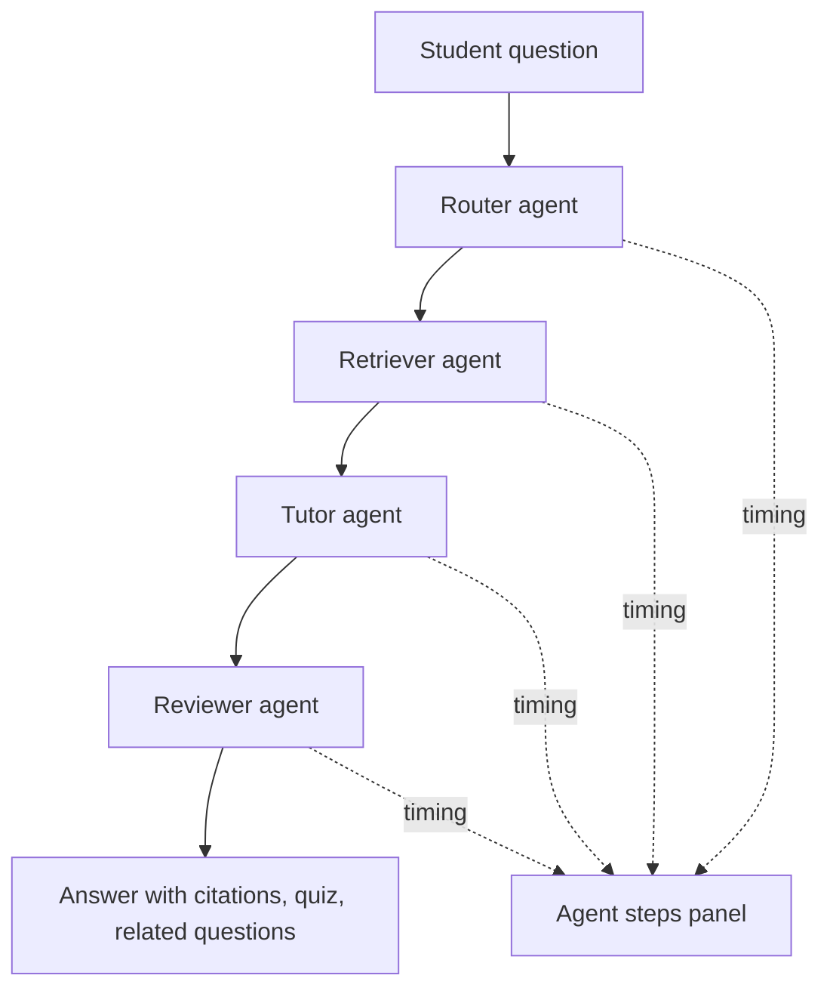

# Subject Guide & Question Bank AI Agent

An AI study assistant for students. It reads course material (PDF, DOCX, PPTX), explains topics, answers questions, solves problems, and generates quizzes using the provided material, with source references.

## Live demos

- **Track A – Streamlit:** https://subject-guideagent-nvmsyd5d2gmqcemdjpjhgz.streamlit.app/
- **Track B – React + FastAPI:** https://subject-guide-agent.onrender.com

Both deployments are maintained separately.

## Problem statement

Students keep their course material in many places: lecture slides, textbook chapters, lab manuals, and past question papers. When they revise, they cannot quickly get an explanation of one topic based on their own material, linked to exam questions and clear about its sources.

## Target users

Undergraduate students preparing for semester exams (built and tested with AIML course material), and anyone who wants to study from their own files.

## Success criteria

- Every answer shows the file and slide or page it came from.
- Answers use the provided material and indicate when it does not cover a question.
- Syllabus topics have study material and past questions tracked by the coverage report.
- The app runs at public links and works with students' uploaded files.

## Team and responsibilities

| Member | Role |
|---|---|
| Ioniixia | Data and retrieval: document loading, chunking, metadata tagging, FAISS index, syllabus and question tagging, coverage report, deployment, README |
| Yitong | Agent and app: agent steps, Gemini answer generation, study modes, quiz, related past questions, filters, Streamlit interface |

## Project plan

| Week | Deliverable | Status |
|---|---|---|
| 1 | Repository, README, problem statement, document loading, chunking, FAISS index | Done |
| 2 | Multi-format ingestion, source tagging, RAG pipeline, Streamlit app | Done |
| 3 | Study modes, subject and chapter filters, AIML notes indexed | Done |
| 4 | Question bank, quiz, related past questions, public deployment | Done |
| 5 | Agent pipeline, syllabus, topic tags, coverage report | Done |
| 6 | Practice mode, progress tracking, weak-area detection, study plan, backend API | Implemented |
| 7 | React frontend, guardrails, edge-case testing | Implemented |
| 8 | Docker deployment, public deployment, README updates | Deployment done; documentation ongoing |

## Features

- **Agent mode:** Questions go through Router, Retriever, Tutor, and Reviewer steps.
- **Study modes:** Ask a question, solve a problem step by step, or learn a topic.
- **Test yourself:** Generate multiple-choice quizzes.
- **Related past questions:** Find matching exam questions.
- **Filters:** Subject, chapter, and source type.
- **Marks field:** Adjust answer length for 2, 5, or 10 mark questions.
- **Source citations:** Show file, chapter, slide, or page references.
- **Multi-file upload:** Upload PDF, DOCX, and PPTX files.
- **Progress tracking:** Track learning and practice progress.
- **Study plan:** Organize revision with a study plan.
- **Coverage report:** Identify syllabus topics with missing study material or questions.

## Track A – Streamlit

Track A is the original Streamlit implementation.

**Deployment:** https://subject-guideagent-nvmsyd5d2gmqcemdjpjhgz.streamlit.app/

Technology:
- Python
- Streamlit
- LangChain
- FAISS
- Sentence-Transformers
- Google Gemini

## Track B – React + FastAPI

Track B is the newer web application, with a React frontend and FastAPI backend served from a single Docker container.

**Deployment:** https://subject-guide-agent.onrender.com

Technology:
- React
- Vite
- Python
- FastAPI
- Uvicorn
- Docker
- FAISS
- Sentence-Transformers
- Google Gemini

The deployed application uses the `all-MiniLM-L6-v2` embedding model and supports document retrieval from uploaded study material.

The Track B deployment was tested successfully for:
- Application startup and public access.
- PDF upload.
- Retrieval of relevant PDF content.
- Question answering and MCQ generation.

## Architecture



## Tools

| Tool | What it does | Status |
|---|---|---|
| Answer a question | Short answer from notes, with citations | Integrated |
| Teach a topic | Lesson with theory, examples, and practice | Integrated |
| Solve a problem | Step-by-step solution | Integrated |
| Quiz | Three-question quiz on a topic | Integrated |
| Past questions | Related exam questions | Integrated |
| Practice | Practice questions and exercises | Implemented |
| Progress tracking | Track quiz and practice progress | Implemented |
| Weak-area detection | Identify topics to revise | Implemented |
| Study plan | Organize revision | Implemented |
| Coverage report | Identify topics with missing notes or questions | Built |

## System design

- **Ingestion:** PDF, DOCX, and PPTX files are loaded by type. Slides are read one at a time, and question papers are split so each question is its own chunk.
- **Metadata:** Every chunk carries source type, subject, chapter, topic, and slide or page information.
- **Embeddings and search:** Chunks are embedded with `all-MiniLM-L6-v2` and searched using FAISS.
- **Generation:** Gemini generates answers from retrieved content in the selected study mode, with inline citations.
- **Storage:** The built-in index is saved in `faiss_index/`. Syllabus and tags are stored as JSON files in `data/`.
- **Deployment:** Track A uses Streamlit Cloud. Track B uses Render with Docker.

## LLM and embedding choices

We compared the four models our agent can use. Each one answered the same five questions from AIML notes, using the same prompt and the top three retrieved note chunks.

| Model | Avg response time | Keyword accuracy | Answers with citations | Errors |
|---|---|---|---|---|
| gemini-2.5-flash-lite | Not available (404) | - | - | 5 of 5 |
| gemini-3.1-flash-lite | 1.5 s | 93% | 5 of 5 | 0 |
| gemini-flash-latest | 100.3 s | 100% | 3 of 3 | 2 (503) |
| gemini-3.5-flash | 4.4 s | 83% | 4 of 4 | 1 (503) |

**Choice:** `gemini-3.1-flash-lite` is the main model because it was fast, had no errors, and cited its sources consistently in the test.

**Embeddings:** `all-MiniLM-L6-v2` from Sentence-Transformers. It is free, runs locally, and is suitable for the project's index.

## Error handling and logging

- If Gemini is unavailable, the request is retried and the next model in the list is tried.
- Empty questions are rejected with a message.
- Each agent step records its execution time.

## Run locally

Clone the repository:

```bash
git clone https://github.com/Ioniixia/Subject-Guide_agent.git
cd Subject-Guide_agent
```

Install backend dependencies:

```bash
pip install -r requirements.txt
```

Create a `.env` file in the project root:

```env
GEMINI_API_KEY=your_key_here
```

For Track A:

```bash
python -m streamlit run app/streamlit_app.py
```

For Track B, install frontend dependencies and run the frontend and backend using the project's development setup.

## Using your own notes

The sample question papers, textbook chapter, and lab manual in `data/` are examples written for this project, not real exam papers.

To build the index from your own files:

1. Put your PDF, DOCX, or PPTX files in `data/`.
2. Edit the `file_configs` list in `src/build_index.py` with each file's path, source type, subject, and chapter.
3. List units and topics in `data/syllabus.json`.
4. Tag questions and slides in the relevant JSON files.
5. Run `python src/build_index.py`.
6. Run `python src/coverage_check.py` to check for missing topics.

## Project structure

```text
app/           Streamlit app, FastAPI backend, agents and study features
frontend/      React and Vite frontend
src/           Document loading, chunking, tagging and indexing
data/          Sample study material, syllabus and topic tags
faiss_index/   Saved built-in index
```

## Team

Ioniixia and yitong2907
