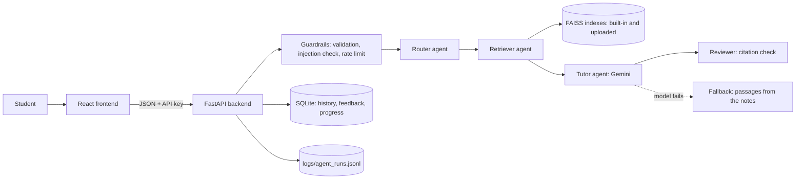

# 📚 Academic Subject Guide AI

An AI study assistant that learns from **your own** notes, textbooks, lab manuals and past question papers. Ask it to explain a topic, solve a past-paper question, quiz you, or build a study plan, and every answer cites the file and page it came from.

**Live app:** [paste the Hugging Face Space link]  ·  **Demo video:** [paste the video link]

## Problem, users and success criteria

**Problem.** Students keep their material in many places (slides, notes, a textbook, lab manuals, old papers). A general chatbot does not know that material, so its answers are not tied to the syllabus and cannot be checked.

**Target users.** Undergraduate students preparing for university exams. The sample data covers DBMS and AI/ML.

**Success criteria.**
- Answers cite the uploaded material, and the citations point to real sources.
- A topic gets a complete explanation (theory, example, practice, quiz), and related past questions get solved.
- The app keeps working when the AI model is slow or unavailable.
- Bad input is rejected politely, and nothing from the server's file system reaches the browser.

## Features

- **Multi-document RAG:** upload PDF, DOCX or PPTX files, tag each as notes, textbook, lab manual or question paper, and filter by subject, chapter and source type.
- **Agents:** a router picks the right tool (answer, solve, teach, quiz, past questions), a retriever finds the material, a tutor writes the answer with Gemini, and a reviewer checks the citations. An **Agent steps** panel shows each step and the model used.
- **Study tools:** step-by-step problem solving with a marks setting, theory → example → practice lessons, a scored quiz, a practice mode over past-paper questions, progress by chapter, weak-area detection, a day-by-day study plan, and one-click revision.
- **Product features:** chat history, thumbs up/down feedback, usage analytics from the run log, Markdown export.
- **Guardrails and fallbacks:** see [Guardrails](#guardrails).
- **Two interfaces:** a React app (main) and a Streamlit app.

## Architecture



**What happens to one question**

1. The message is validated (not empty, under 2,000 characters, no prompt-injection phrases).
2. The **Router** chooses a tool (Gemini, with keyword rules as a fallback).
3. The **Retriever** searches the FAISS indexes with the chosen subject, chapter and source-type filters. Chunks that contain instruction-like text are skipped.
4. The **Tutor** writes the answer with Gemini, using only the retrieved chunks and citing them as [1], [2]. Models are tried in order and each request times out after 30 seconds.
5. The **Reviewer** checks that every citation points to a real source.
6. The answer, sources, related past questions and the step trace go back to the frontend. The run is written to the log.

**Document processing.** Files are loaded (PyPDF, docx2txt, python-pptx), split into chunks, tagged with `source_type`, `subject` and `chapter` (question papers are split per question, with `question_no`, `year` and `marks`), embedded with `all-MiniLM-L6-v2` and stored in FAISS.

## Tech stack

| Part | Technology |
|---|---|
| Backend | Python 3.12, FastAPI, Uvicorn |
| RAG | LangChain (loaders, splitter), FAISS, sentence-transformers `all-MiniLM-L6-v2` |
| LLM | Google Gemini (`gemini-3.1-flash-lite`, `gemini-3.5-flash`, `gemini-flash-latest`) |
| Storage | SQLite (history, feedback, progress), JSON-lines run log |
| Frontend | React, Vite, react-markdown (also a Streamlit app) |
| Tests | pytest, Vitest and Testing Library |
| Deployment | Docker, Hugging Face Spaces |

## Project structure

```
app/        backend: api.py, agent*.py, guardrails.py, llm.py, prompts.py, core.py, db.py, planner.py, ...
src/        document loading, chunking and index building
data/       sample documents
faiss_index/ the built-in index
frontend/   React app
tests/      backend tests
scripts/    benchmark.py, pin_versions.py
Dockerfile  one container for the API and the built React app
```

## Setup

**Requirements:** Python 3.12, Node.js 20 or newer, and a free [Gemini API key](https://aistudio.google.com/apikey).

```bash
git clone https://github.com/Ioniixia/Subject-Guide_agent.git
cd Subject-Guide_agent
python -m venv venv
source venv/Scripts/activate        # Windows PowerShell: .\venv\Scripts\Activate.ps1
pip install -r requirements.txt
```

Create a `.env` file in the repo root (see [Environment variables](#environment-variables)):

```
GEMINI_API_KEY=your_key_here
```

The repository includes a built `faiss_index/`. To rebuild it from `data/`: `python src/build_index.py`.

**Run the backend and the React app (development)**

```bash
python -m uvicorn app.api:app --reload            # terminal 1: http://127.0.0.1:8000/docs
cd frontend && npm install && npm run dev         # terminal 2: http://localhost:5173
```

In the app's **Settings**, enter the server address, the API key and your name.

**Run it as one server (like the deployed app)**

```bash
cd frontend && npm install && npm run build && cd ..
python -m uvicorn main:app --app-dir app          # http://127.0.0.1:8000
```

**Run the Streamlit app instead:** `python -m streamlit run app/streamlit_app.py`

## Environment variables

| Variable | Needed | Meaning |
|---|---|---|
| `GEMINI_API_KEY` | yes | Your Gemini key |
| `API_KEY` *(use the exact name read in `app/api.py`)* | yes | The key the frontend sends in the `X-API-Key` header |
| `GEMINI_TIMEOUT_SECONDS` | no (30) | A model that takes longer is skipped for the next one |
| `RATE_LIMIT_PER_MIN` | no (30) | Requests per user per minute |
| `APP_DB` | no (`data/app.db`) | SQLite file |
| `AGENT_LOG_DIR` | no (`logs`) | Folder for the run log |
| `VITE_API_URL`, `VITE_API_KEY_HEADER` | no | Frontend build settings (backend address, key header name) |

Never put API keys in `frontend/.env` for a deployed site: everything in the build is public. Users type the key into the app's Settings box, and it stays in their browser.

## Deployment (Hugging Face Spaces)

The `Dockerfile` builds the React app and serves it from the same FastAPI server, so one address does everything and no CORS setup is needed.

1. Create a Space at huggingface.co/new-space: **SDK: Docker**, blank template, public.
2. Add this block at the very top of `README.md`:
   ```
   ---
   title: Academic Subject Guide AI
   emoji: 📚
   colorFrom: blue
   colorTo: indigo
   sdk: docker
   app_port: 7860
   ---
   ```
3. In the Space's **Settings → Variables and secrets**, add the secrets `GEMINI_API_KEY` and the API key variable from the table above.
4. Push the code to the Space:
   ```bash
   git remote add space https://huggingface.co/spaces/<your-username>/<space-name>
   git push space main
   ```
   Use your Hugging Face username and a **write** access token as the password.
5. Wait for the build (about 10 to 15 minutes the first time) and open the Space's address.

Other hosts work too, for example Render or Railway with a Docker service. Pick a plan with at least 2 GB of memory, because the embedding model needs it.

## API

The interactive documentation is at `/docs`. Every endpoint except `/health` needs the API key.

| Endpoint | Purpose |
|---|---|
| `POST /upload`, `GET /filters`, `POST /search` | Add files, list subjects and chapters, search the index |
| `POST /ask` | The agent chooses a tool, retrieves, answers and reviews |
| `POST /quiz`, `POST /practice-answers` | Quiz and practice answers for a topic |
| `GET /past-questions` | Past-paper questions, newest first |
| `POST /feedback`, `GET /history` | Thumbs up/down and recent questions |
| `POST /progress`, `GET /progress`, `GET /weak-areas` | Scores per chapter and weak areas |
| `POST /study-plan` | Day-by-day plan to the exam |
| `GET /analytics` | Runs per tool, error rate, average times |

*(Paste the full request and reply tables from `API_ENDPOINTS.md` here.)*

## Guardrails

| Guardrail | Where |
|---|---|
| Input validation: empty, over 2,000 characters, control characters | `app/guardrails.py`, `app/agent_routes.py` |
| Prompt-injection check on the message | `app/guardrails.py` |
| Retrieved chunks with instruction-like text are skipped | `app/guardrails.py`, `app/agent_service.py` |
| Safety rules in every prompt | `app/prompts.py` |
| Rate limit: 30 requests per minute per user | `app/guardrails.py` |
| Fallback when Gemini fails: the most relevant passages from the notes | `app/agent_service.py` |
| Fallback when the router fails: keyword rules | `app/agent.py` |
| 30-second timeout, then the next model | `app/llm.py` |
| No server paths in replies | `app/agent_service.py` |
| Upload limits: file type and size | `app/api.py` |

## Tests

```bash
pip install pytest httpx
python -m pytest tests -q        # backend: 59 tests, no API key needed
cd frontend && npm test          # frontend: 27 tests
```

The tests use a small index and a fake Gemini, so they give the same result on any machine.

## Results

Measured with `python scripts/benchmark.py --url <address> --key <API key>` on 10 sample questions:

*(Paste the table printed by the script here.)*

## Screenshots

| | |
|---|---|
|  |  |
|  |  |
|  |  |

## Known limitations

- **Uploads are shared.** Uploaded files go into one index on the server, not one per user, and they disappear when the server restarts.
- **Storage is temporary on free hosts.** Progress, feedback and logs reset when the app restarts or redeploys.
- **Simple access control.** One shared API key and a name typed by the user, with no accounts or passwords. The key is entered in the browser.
- **Rate limiting is in memory,** so it resets on restart and is per server process.
- **Free-tier limits.** If the Gemini quota runs out, answers fall back to passages from the notes. A sleeping Space is slow on its first request.
- **Material quality limits answers.** Scanned PDFs are not read (no OCR), and the app works in English only.
- **Sample data.** The question papers in `data/` are sample questions we wrote, not real exam papers, and only DBMS and AI/ML are included.
- **Rule-based planning.** The study plan and weak-area detection use simple rules, not a learned model.
- **Router latency.** Smart routing uses one extra Gemini call per question. It can be switched off in the sidebar.
- **Tests.** The frontend tests use a mocked backend, and there are no browser-level end-to-end tests.

## Team

| Member | Contribution |
|---|---|
| Ioniixia | Document loading and chunking, tagging, FAISS index, question-paper splitting, the FastAPI app (upload, filters, search, authentication), documentation |
| Yitong | Gemini integration, agents (router, tutor, reviewer), study modes, quiz, practice, progress, study plan, agent API endpoints, guardrails, Streamlit and React interfaces, tests, deployment setup |

## Future scope

Per-user accounts and private indexes, a permanent database, OCR for scanned papers, Hindi and other languages, adaptive difficulty, a knowledge graph of prerequisite topics, and syllabus-aware study plans.
